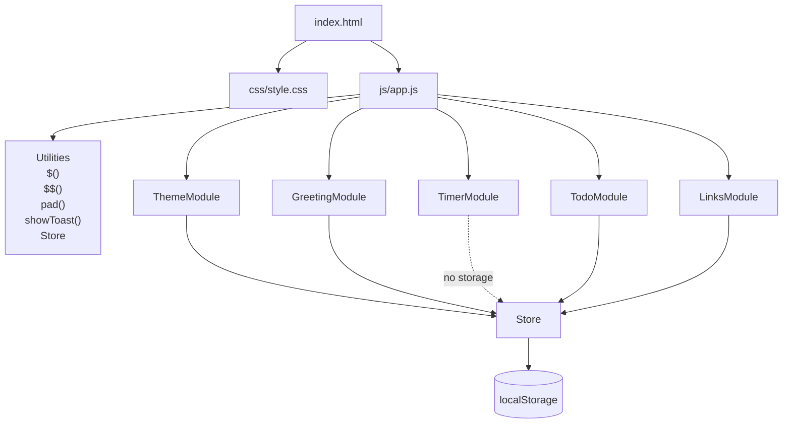

# Design Document

> **Note:** This is a documentation spec for an **existing, fully-implemented** application. No implementation work is needed — every section describes code already present in `index.html`, `css/style.css`, and `js/app.js`.

---

## Overview

Life Dashboard is a single-page web application built with vanilla HTML, CSS, and JavaScript. It has no build step, no framework, and no backend. The page opens directly in any modern browser as a local file. All user data is persisted in `localStorage`.

The dashboard provides five widgets in a single page:

- A live clock, date, and time-based greeting with an optional personalised name
- A light/dark theme toggle with persistence
- A 25-minute Pomodoro focus timer with an SVG progress ring
- A persistent to-do list with inline editing
- A persistent quick-links grid that opens sites in new tabs

---

## Architecture

### Technology stack

| Layer | Choice | Notes |
|---|---|---|
| Markup | HTML5 | Single `index.html` file |
| Styling | CSS3 with custom properties | Single `css/style.css` file |
| Logic | Vanilla JavaScript (ES2017+) | Single `js/app.js` file, no transpilation |
| Persistence | Browser `localStorage` | JSON-serialised values |
| Rendering | Direct DOM manipulation | No virtual DOM or templating engine |

### Module architecture

Each feature is an IIFE (Immediately Invoked Function Expression) that returns a single `{ init }` object. All modules are initialised inside one `DOMContentLoaded` listener at the bottom of `app.js` in this order:

```
DOMContentLoaded
  └─ ThemeModule.init()
  └─ GreetingModule.init()
  └─ TimerModule.init()
  └─ TodoModule.init()
  └─ LinksModule.init()
```

Modules do not import or reference each other. The only shared resources are the `Store`, `showToast`, `$`, `$$`, and `pad` utilities defined at the top of the file in the outer scope.



---

## Components and Interfaces

### Shared utilities

#### `$(sel, ctx?)` / `$$(sel, ctx?)`
Thin wrappers around `querySelector` / `querySelectorAll`. `$$` spreads the NodeList into an Array. `ctx` defaults to `document`.

#### `pad(n)`
Zero-pads an integer to two digits (e.g. `pad(7)` → `"07"`).

#### `showToast(msg, duration?)`
Creates a `.toast` `<div>`, appends it to `#toast-container`, fades it in via two nested `requestAnimationFrame` calls that add the `.show` class, then removes it after `duration` ms (default 2500) plus a 300 ms CSS fade-out.

#### `Store`
JSON-safe `localStorage` wrapper with `try/catch` guards on both read and write.

| Method | Signature | Behaviour |
|---|---|---|
| `get` | `(key: string, fallback?: any) → any` | Returns parsed JSON value or `fallback` on miss or parse error |
| `set` | `(key: string, value: any) → void` | Serialises to JSON and writes; silently ignores write errors |

---

### ThemeModule

**Responsibility:** Maintains and persists the active light/dark theme.

**localStorage key:** `dashboard_theme` (`"light"` | `"dark"`, default `"light"`)

**DOM interaction:**

| Element | Action |
|---|---|
| `document.documentElement` | Reads/writes `data-theme` attribute |
| `#theme-toggle` | Updates button label text |

**Public interface:** `{ init() }`

**Internal functions:**

- `apply(theme)` — sets `data-theme` on `<html>`, updates the button label to `"☀️ Light Mode"` (dark) or `"🌙 Dark Mode"` (light)
- `init()` — reads saved theme (defaults to `"light"`), calls `apply()`, attaches a `click` listener that flips the theme, calls `apply()`, and persists the new value

---

### GreetingModule

**Responsibility:** Displays a live 12-hour clock, the full date, and a time-based greeting optionally personalised with a saved name.

**localStorage key:** `dashboard_name` (string, up to 30 chars, default `""`)

**DOM interaction:**

| Element | Action |
|---|---|
| `#greeting-time` | Clock string written every tick |
| `#greeting-date` | Date string written every tick |
| `#greeting-text` | Greeting + name string written every tick |
| `#name-input` | Pre-filled on load; read on save |
| `#name-save` | Triggers `saveName()` on click |

**Public interface:** `{ init() }`

**Internal functions:**

- `getGreeting(hour)` — returns the emoji+text greeting for a given 0–23 hour value using the lookup table below
- `tick()` — reads the current `Date`, formats and writes all three display elements; called immediately on init and every 1000 ms via `setInterval`
- `saveName()` — trims `#name-input.value`; if empty, shows a toast and returns; otherwise saves to `localStorage`, calls `tick()`, and shows a confirmation toast

**Greeting hour ranges:**

| Range | Text |
|---|---|
| `[5, 12)` | `🌅 Good morning` |
| `[12, 17)` | `☀️ Good afternoon` |
| `[17, 21)` | `🌆 Good evening` |
| `[21, 24)` or `[0, 5)` | `🌙 Good night` |

**Clock format:** `HH:MM:SS AM/PM` (12-hour, zero-padded)

**Date format:** `DayName, MonthName D, YYYY` using hard-coded `DAYS` and `MONTHS` arrays

**Name reading strategy:** The module reads `dashboard_name` from `localStorage` on **every tick** rather than caching it, so an external change takes effect within one second.

---

### TimerModule

**Responsibility:** Runs a 25-minute (1500 s) Pomodoro countdown with a circular SVG progress ring.

**localStorage:** None — all state is in-memory.

**Constants:**

| Name | Value |
|---|---|
| `TOTAL` | `1500` (seconds) |
| `CIRCUMFERENCE` | `2 * Math.PI * 70 ≈ 440` |

**State variables:**

| Variable | Type | Description |
|---|---|---|
| `remaining` | `number` | Seconds left in the current session |
| `interval` | `number \| null` | `setInterval` handle; `null` when not running |
| `running` | `boolean` | Whether the timer is actively counting down |

**DOM interaction:**

| Element | Action |
|---|---|
| `#timer-label` | Displays `MM:SS` countdown |
| `#timer-status` | Displays state text ("Ready", "Focus session in progress…", "Paused", "Session complete! 🎉") |
| `#timer-progress` | `strokeDashoffset` driven by `remaining` |
| `#timer-circle` | Receives `.running` / `.finished` classes |
| `#timer-start` | Label changes between "▶ Start", "⏸ Pause", "▶ Resume" |
| `#timer-stop` | Clears interval without resetting |
| `#timer-reset` | Resets to initial state |

**Public interface:** `{ init() }`

**Internal functions:**

- `formatTime(sec)` — `MM:SS` string from seconds
- `updateRing(sec)` — sets `strokeDashoffset = CIRCUMFERENCE * (1 - sec / TOTAL)`
- `render()` — synchronises all DOM elements to current state; called after every state mutation
- `start()` — if running: pause (clear interval, `running=false`); else: `running=true`, start interval
- `stop()` — clears interval, `running=false`, calls `render()` (remaining unchanged)
- `reset()` — clears interval, `remaining=TOTAL`, calls `render()`
- `tick()` (internal interval callback) — decrements `remaining`; if hits 0, clears interval, `running=false`, calls `render()`, fires 4000 ms toast

---

### TodoModule

**Responsibility:** Maintains a persistent list of tasks supporting add, toggle-complete, inline edit, and delete.

**localStorage key:** `dashboard_todos` (array of `{id, text, done}`, default `[]`)

**Task shape:**

```typescript
{ id: string, text: string, done: boolean }
```

**ID generation:** `Date.now().toString(36) + Math.random().toString(36).slice(2)`

**DOM interaction:**

| Element | Action |
|---|---|
| `#todo-input` | Task text input; cleared and re-focused after add |
| `#todo-add` | Triggers `addTodo()` on click |
| `#todo-list` | `<ul>` rebuilt from scratch on every mutation |

**Public interface:** `{ init() }`

**Internal functions:**

- `load()` — reads `dashboard_todos` from storage into the `todos` array
- `save()` — writes `todos` to storage
- `genId()` — generates a unique string ID
- `addTodo()` — trims input; if empty shows toast and returns; otherwise appends `{id, text, done:false}`, saves, re-renders, clears and focuses the input
- `toggleDone(id)` — flips `done` on the matching task, saves, re-renders
- `deleteTodo(id)` — filters the matching task out, saves, re-renders, shows toast
- `startEdit(id, li)` — replaces the `.todo-text` span with a focused `.todo-edit-input` pre-filled with the current text; hides the edit button
- `render()` — rebuilds `#todo-list` from the `todos` array; renders a `.todo-empty` placeholder when the array is empty

**Inline edit lifecycle:**

```
click ✏️
  └─ replaceWith <input.todo-edit-input> (pre-filled, focused)
        ├─ Enter      → blur()
        ├─ Escape     → restore original value → blur()
        └─ blur       → commit(): trim value
                            ├─ non-empty → update task.text, save()
                            └─ empty     → keep original text
              → render()
```

---

### LinksModule

**Responsibility:** Maintains a persistent grid of quick-launch website links.

**localStorage key:** `dashboard_links` (array of `{id, name, url}`, default `[]`)

**Link shape:**

```typescript
{ id: string, name: string, url: string }
```

**DOM interaction:**

| Element | Action |
|---|---|
| `#link-name` | Site name input |
| `#link-url` | Site URL input |
| `#link-add` | Triggers `addLink()` on click |
| `#links-grid` | `<div>` rebuilt from scratch on every mutation |

**Public interface:** `{ init() }`

**Internal functions:**

- `load()` / `save()` — read/write `dashboard_links` via `Store`
- `genId()` — same algorithm as `TodoModule`
- `normalizeUrl(raw)` — if the trimmed string already starts with `http://` or `https://` (case-insensitive), returns it unchanged; otherwise prepends `https://`
- `faviconUrl(href)` — constructs `https://www.google.com/s2/favicons?domain=HOSTNAME&sz=32` by parsing the URL hostname; returns `""` if parsing fails
- `addLink()` — validation sequence: trim name (empty → toast + focus `#link-name`, return); normalize URL (empty → toast + focus `#link-url`, return); `new URL()` throws → toast + focus `#link-url`, return; on success: append `{id, name, url}`, save, re-render, clear inputs, focus `#link-name`, show confirmation toast
- `deleteLink(id)` — filters the matching link out, saves, re-renders, shows toast
- `render()` — rebuilds `#links-grid`; renders a `.links-empty` placeholder when the array is empty; favicon `` elements use `onerror` to self-remove if the fetch fails

---

## Data Models

### localStorage schema

| Key | Type | Default | Description |
|---|---|---|---|
| `dashboard_theme` | `"light" \| "dark"` | `"light"` | Active theme |
| `dashboard_name` | `string` | `""` | User display name (max 30 chars in HTML) |
| `dashboard_todos` | `Array<TodoItem>` | `[]` | Ordered list of to-do items |
| `dashboard_links` | `Array<LinkItem>` | `[]` | Ordered list of quick links |

### TodoItem

```
{
  id:   string   // base-36 timestamp + random suffix
  text: string   // trimmed task description (max 120 chars in HTML)
  done: boolean  // completion state
}
```

### LinkItem

```
{
  id:   string   // base-36 timestamp + random suffix
  name: string   // display label (max 30 chars in HTML)
  url:  string   // normalised absolute URL (always has http:// or https:// scheme)
}
```

---

## Correctness Properties

*A property is a characteristic or behavior that should hold true across all valid executions of a system — essentially, a formal statement about what the system should do. Properties serve as the bridge between human-readable specifications and machine-verifiable correctness guarantees.*

### Property 1: Clock format validity

*For any* combination of hour (0–23), minute (0–59), and second (0–59), the formatted clock string produced by the `tick()` time-formatting logic must match the pattern `HH:MM:SS AM/PM` where the hour component is in `[01, 12]`.

**Validates: Requirements 1.2**

---

### Property 2: Date format validity

*For any* `Date` object, the formatted date string produced by `tick()` must contain a valid day name from `DAYS`, a valid month name from `MONTHS`, the numeric day of the month, and the four-digit year — all in the order `DayName, MonthName D, YYYY`.

**Validates: Requirements 1.3**

---

### Property 3: Greeting range coverage

*For any* integer hour in `[0, 24)`, `getGreeting(hour)` returns exactly one of the four defined greeting strings, covering all 24 hours without gaps or overlaps.

**Validates: Requirements 1.4, 1.5, 1.6, 1.7**

---

### Property 4: Name save round-trip

*For any* non-empty string (after trimming), calling `saveName()` with that value stores the trimmed string in `localStorage` under `dashboard_name`, and a subsequent `Store.get('dashboard_name')` returns the same trimmed value.

**Validates: Requirements 2.2**

---

### Property 5: Whitespace name rejection

*For any* string whose `trim()` result is empty (the empty string, spaces, tabs, etc.), calling `saveName()` must not update `Store.get('dashboard_name')` — the stored value remains whatever it was before the call.

**Validates: Requirements 2.3**

---

### Property 6: Theme toggle round-trip

*For any* initial theme value (`"light"` or `"dark"`), clicking `#theme-toggle` twice returns `data-theme` and `Store.get('dashboard_theme')` to the original value. Clicking once sets them to the opposite value.

**Validates: Requirements 3.5**

---

### Property 7: Timer reset invariant

*For any* state of the timer (any value of `remaining`, any value of `running`), calling `reset()` always sets `remaining` to `TOTAL` (1500) and `running` to `false`.

**Validates: Requirements 4.5**

---

### Property 8: Timer ring formula

*For any* integer `remaining` in `[0, 1500]`, `updateRing(remaining)` sets `strokeDashoffset` on `#timer-progress` to exactly `CIRCUMFERENCE * (1 - remaining / TOTAL)`, never producing a value outside `[0, CIRCUMFERENCE]`.

**Validates: Requirements 4.7**

---

### Property 9: Todo add round-trip

*For any* non-empty task description string (after trimming), calling `addTodo()` appends a new item to the in-memory `todos` array and to `Store.get('dashboard_todos')` where the item's `text` property equals the trimmed description and `done` is `false`.

**Validates: Requirements 5.2**

---

### Property 10: Whitespace task rejection

*For any* string whose `trim()` result is empty, calling `addTodo()` must leave the `todos` array length unchanged and must not modify `Store.get('dashboard_todos')`.

**Validates: Requirements 5.3**

---

### Property 11: Todo done toggle round-trip

*For any* task in the `todos` array, calling `toggleDone(id)` twice returns the task's `done` property to its original value. Calling it once inverts the value.

**Validates: Requirements 5.4**

---

### Property 12: Todo edit commit invariant

*For any* task and any committed edit value: if the trimmed value is non-empty, `task.text` is updated to the trimmed value and saved; if the trimmed value is empty, `task.text` retains its previous value and no write occurs.

**Validates: Requirements 5.7**

---

### Property 13: Todo delete removes item

*For any* `todos` array containing an item with a given `id`, calling `deleteTodo(id)` removes that item from both the in-memory `todos` array and from `Store.get('dashboard_todos')` — no item with that `id` remains in either location.

**Validates: Requirements 5.9**

---

### Property 14: URL normalisation

*For any* string that does not start with `http://` or `https://` (case-insensitive), `normalizeUrl()` returns the string with `https://` prepended. For any string that already has either prefix, `normalizeUrl()` returns it unchanged.

**Validates: Requirements 6.6**

---

### Property 15: Link delete removes item

*For any* `links` array containing an item with a given `id`, calling `deleteLink(id)` removes that item from both the in-memory `links` array and from `Store.get('dashboard_links')` — no item with that `id` remains in either location.

**Validates: Requirements 6.11**

---

## Error Handling

### Storage errors

`Store.get` and `Store.set` wrap every `localStorage` call in a `try/catch`. On read failure the configured `fallback` value is returned (never throws). On write failure the error is silently swallowed. This means the application degrades gracefully in private-browsing contexts where `localStorage` is blocked or full.

### URL validation

`LinksModule.addLink()` applies a three-stage validation:
1. Name present (non-empty after trim)
2. URL present after `normalizeUrl()`
3. URL is a valid absolute URL per `new URL()` constructor

Each failure shows a toast and focuses the offending field. The function returns early after the first failure, so only one toast appears per click.

### Favicon load failure

Each favicon `` has an `onerror` handler that calls `img.remove()`. The link card renders correctly without the icon — the site label is always present regardless of favicon availability.

### Edit input empty commit

Committing an empty string during inline edit is treated as a cancellation: the original `task.text` is preserved and no `save()` call is made.

### Timer over-decrement guard

The `tick()` callback checks `remaining <= 0` before decrementing. When `remaining` reaches 0 it fires the completion sequence and clears the interval, so `remaining` can never go below 0.

---

## Testing Strategy

This application has no build step and no test runner configured. The testing strategy below describes what automated tests *would* cover if added.

### Unit tests (example-based)

Unit tests use specific concrete inputs to verify correct behaviour at integration points and edge cases. They are appropriate for:

- Module initialisation from a known `localStorage` state
- Each validation path in `addTodo()`, `addLink()`, and `saveName()` (empty, whitespace, valid input)
- Toast lifecycle (element created, `.show` added, element removed after duration)
- Timer state transitions (Ready → Running → Paused → Running → Complete, Reset at any point)
- Inline edit cancel (Escape key) and commit (Enter / blur)
- Favicon `onerror` removes the image element
- Empty-state placeholders in `#todo-list` and `#links-grid`
- `#toast-container` has `aria-live="polite"` attribute

### Property-based tests

Property-based tests use a library such as [fast-check](https://github.com/dubzzz/fast-check) (JavaScript) to generate hundreds of random inputs and verify universal invariants. Each test must run a **minimum of 100 iterations**.

Tag format for each test: `Feature: life-dashboard, Property {N}: {property_text}`

| Property | Test approach | Generator |
|---|---|---|
| P1 — Clock format validity | Generate random `{h:0–23, m:0–59, s:0–59}`, call formatter, assert regex and hour range | `fc.record({ h: fc.integer({min:0,max:23}), m: fc.integer({min:0,max:59}), s: fc.integer({min:0,max:59}) })` |
| P2 — Date format validity | Generate random `Date` values, call formatter, assert structure | `fc.date()` |
| P3 — Greeting range coverage | Generate random integer hour in `[0, 24)`, call `getGreeting`, assert valid non-empty string with no undefined | `fc.integer({min:0, max:23})` |
| P4 — Name save round-trip | Generate non-empty strings (trimmed), call `saveName`, assert `Store.get` returns trimmed value | `fc.string().filter(s => s.trim().length > 0)` |
| P5 — Whitespace name rejection | Generate whitespace-only strings, assert `Store.get` unchanged | `fc.stringOf(fc.constantFrom(' ', '\t', '\n'))` |
| P6 — Theme toggle round-trip | For each of `'light'` and `'dark'`, simulate two clicks, assert restored | Enumeration (2 cases) |
| P7 — Timer reset invariant | Generate random `{remaining: 0–1500, running: bool}`, call `reset()`, assert state | `fc.record({ remaining: fc.integer({min:0,max:1500}), running: fc.boolean() })` |
| P8 — Timer ring formula | Generate random `remaining` in `[0, 1500]`, call `updateRing`, assert `strokeDashoffset` | `fc.integer({min:0, max:1500})` |
| P9 — Todo add round-trip | Generate non-empty task strings, call `addTodo`, assert last item in store | `fc.string().filter(s => s.trim().length > 0)` |
| P10 — Whitespace task rejection | Generate whitespace-only strings, call `addTodo`, assert array length unchanged | `fc.stringOf(fc.constantFrom(' ', '\t', '\n'))` |
| P11 — Todo done toggle round-trip | Generate task arrays with a target ID, toggle twice, assert `done` unchanged | `fc.array(todoArb)` |
| P12 — Todo edit commit invariant | Generate task + edit string; if trimmed non-empty assert update; else assert no change | `fc.tuple(todoArb, fc.string())` |
| P13 — Todo delete removes item | Generate todo array with ≥1 item, delete a random item, assert absent from both memory and store | `fc.array(todoArb, {minLength:1})` |
| P14 — URL normalisation | Generate strings without protocol, assert `https://` prefix; generate valid URLs, assert unchanged | `fc.webUrl()` and `fc.string()` |
| P15 — Link delete removes item | Generate links array with ≥1 item, delete a random item, assert absent from both memory and store | `fc.array(linkArb, {minLength:1})` |

### Not covered by property-based tests

The following aspects are not suitable for PBT and are covered by unit tests or manual checks:

- CSS hover states and visual transitions
- `aria-live` attribute presence (smoke test)
- Favicon fetch failure (requires a mock `Image` or fake network)
- Toast stacking layout (CSS behavior)
- Opening links in `_blank` tab (browser navigation side-effect)
